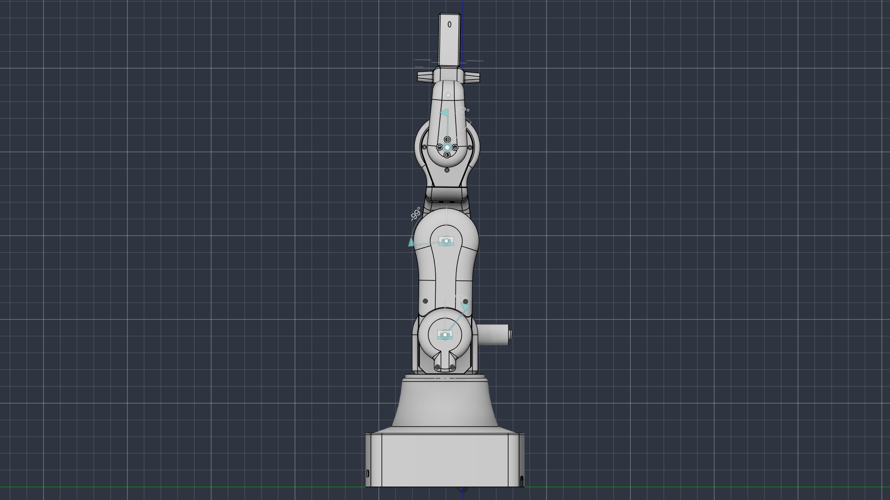

# marav3best — Robot Description



## Overview

| Property | Value |
|----------|-------|
| Total mass | 4.873 kg |
| Links | 12 |
| Joints | 11 (9 movable) |
| Assemblies | 4 |
| Root link | `base_link` |

## Table of Contents

- [Kinematic Tree](#kinematic-tree)
- [Link Properties](#link-properties)
- [Joint Properties](#joint-properties)
- [Assembly Breakdown](#assembly-breakdown)
- [Quick Start (ROS 2)](#quick-start-ros-2)
- [Files](#files)

## Kinematic Tree

```
base_link [BAKE]
  └─ J1_yaw_base_shoulderLink [continuous]
    RG_shoulder_link [BAKE]
      └─ J2_pitch_shoulder [continuous]
        RG_shoulder_arm [BAKE]
          └─ J3_rigid_shoulderArm_elbowLink [fixed]
            RG_elbow_link
              └─ J4_pitch_elbow [continuous]
                RG_elbow_arm [BAKE]
                  └─ J5_rigid_elbowArm_wristLink [fixed]
                    RG_wrist_link
                      └─ J6_pitch_wrist [continuous]
                        RG_wrist_arm [BAKE]
                          └─ J9_horn_drive [continuous]
                            RG_gripper_horn [BAKE]
                              └─ J10_horn_link1 [continuous]
                                marav3best_gripper_2nd_link [BAKE]
                                  └─ J12_link1_tooth1 [continuous]
                                    marav3best_gripper [BAKE]
                              └─ J11_horn_link2 [continuous]
                                marav3best_gripper_2nd_link_2 [BAKE]
                                  └─ J13_link2_tooth2 [continuous]
                                    marav3best_gripper_2 [BAKE]
```

## Link Properties

| Link | Mass (kg) | Material | Collision | Bodies |
|------|-----------|----------|-----------|--------|
| `RG_elbow_arm` | 0.6897 | Generic | visual_reuse | 1 |
| `RG_elbow_link` | 0.3550 | Generic | visual_reuse | 1 |
| `RG_gripper_horn` | 0.0155 | Generic | visual_reuse | 1 |
| `RG_shoulder_arm` | 0.7392 | Generic | visual_reuse | 1 |
| `RG_shoulder_link` | 0.5152 | Generic | visual_reuse | 1 |
| `RG_wrist_arm` | 0.5168 | Generic | visual_reuse | 1 |
| `RG_wrist_link` | 0.1064 | Generic | visual_reuse | 1 |
| `base_link` | 1.8358 | Generic | visual_reuse | 1 |
| `marav3best_gripper` | 0.0485 | Generic | visual_reuse | 1 |
| `marav3best_gripper_2` | 0.0485 | Generic | visual_reuse | 1 |
| `marav3best_gripper_2nd_link` | 0.0010 | Generic | visual_reuse | 1 |
| `marav3best_gripper_2nd_link_2` | 0.0010 | Generic | visual_reuse | 1 |

## Joint Properties

| Joint | Type | Parent → Child | Axis | Limits |
|-------|------|---------------|------|--------|
| `J10_horn_link1` | continuous | `RG_gripper_horn` → `marav3best_gripper_2nd_link` | (0,0,1) | — |
| `J11_horn_link2` | continuous | `RG_gripper_horn` → `marav3best_gripper_2nd_link_2` | (0,0,1) | — |
| `J12_link1_tooth1` | continuous | `marav3best_gripper_2nd_link` → `marav3best_gripper` | (0,0,1) | — |
| `J13_link2_tooth2` | continuous | `marav3best_gripper_2nd_link_2` → `marav3best_gripper_2` | (0,0,1) | — |
| `J1_yaw_base_shoulderLink` | continuous | `base_link` → `RG_shoulder_link` | (0,0,1) | — |
| `J2_pitch_shoulder` | continuous | `RG_shoulder_link` → `RG_shoulder_arm` | (0,0,1) | — |
| `J3_rigid_shoulderArm_elbowLink` | fixed | `RG_shoulder_arm` → `RG_elbow_link` | (0,0,1) | — |
| `J4_pitch_elbow` | continuous | `RG_elbow_link` → `RG_elbow_arm` | (0,0,1) | — |
| `J5_rigid_elbowArm_wristLink` | fixed | `RG_elbow_arm` → `RG_wrist_link` | (0,0,1) | — |
| `J6_pitch_wrist` | continuous | `RG_wrist_link` → `RG_wrist_arm` | (0,0,1) | — |
| `J9_horn_drive` | continuous | `RG_wrist_arm` → `RG_gripper_horn` | (0,0,1) | — |

## Assembly Breakdown

### 16_to_1_planetary_gearbox

- **Links**: 
- **Total mass**: 0.000 kg

### 36_to_1_planetary_gearbox

- **Links**: 
- **Total mass**: 0.000 kg

### 6_to_1_planetary_gearbox

- **Links**: 
- **Total mass**: 0.000 kg

### marav3best

- **Links**: base_link, RG_shoulder_link, RG_elbow_link, RG_wrist_link, RG_gripper_horn, marav3best_gripper_2nd_link, marav3best_gripper_2nd_link_2, marav3best_gripper, marav3best_gripper_2, RG_wrist_arm, RG_shoulder_arm, RG_elbow_arm
- **Total mass**: 4.873 kg

## Quick Start (ROS 2)

```bash
# 1. Copy package to your ROS 2 workspace
cp -r marav3best_description ~/ros2_ws/src/

# 2. Build
cd ~/ros2_ws
colcon build --packages-select marav3best_description
source install/setup.bash

# 3. Visualize in RViz2
ros2 launch marav3best_description display.launch.py

# 4. Validate URDF structure
check_urdf install/marav3best_description/share/marav3best_description/urdf/marav3best.urdf

# 5. Print kinematic tree
urdf_to_graphviz install/marav3best_description/share/marav3best_description/urdf/marav3best.urdf
```

**Joint control**: The launch file includes `joint_state_publisher_gui` —
use the sliders to move revolute/prismatic joints in RViz2.

**Topic inspection**:
```bash
# See published joint states
ros2 topic echo /joint_states

# See robot description parameter
ros2 param get /robot_state_publisher robot_description
```

## Files

| Path | Description |
|------|-------------|
| `urdf/marav3best.urdf.xacro` | Top-level xacro (entry point) |
| `urdf/marav3best.urdf` | Flat URDF (for validation) |
| `urdf/assemblies/` | Per-assembly xacro macros |
| `meshes/` | Visual (OBJ) and collision (STL) meshes |
| `launch/display.launch.py` | Launch robot_state_publisher, RViz, and generated controllers |
| `config/joint_state.yaml` | Joint state publisher config |
| `config/ros2_controllers.yaml` | Generated ros2_control controller manager config |
| `robot_data.yaml` | Supplementary data (beyond URDF) |
| `docs/transforms.md` | Transformation matrices (KaTeX) |

## Customizing

Assemblies tagged `!dummy_` are designed to be swapped out. To replace one:

1. Create your replacement as a xacro macro with the same interface
2. Place it in `urdf/assemblies/`
3. Update the `<xacro:include>` in `urdf/marav3best.urdf.xacro`
4. Update meshes in `meshes/<your_assembly>/`

The xacro prefix system (`${prefix}`) ensures link names stay unique
when multiple instances of the same assembly are used.

---
*Generated by Fusion URDF/XACRO Exporter v3.1.1*